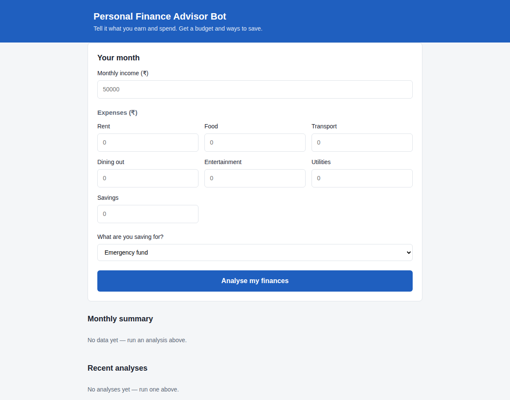

# Personal Finance Advisor Bot

A Flask web app where you enter your monthly income, expenses and a savings goal. It sends them to Google Gemini and shows a suggested budget, which categories are overspent, and a few ways to save. Made for the SkillWallet Personal Finance Advisor Bot project (AI Specialist - BFSI).

**Built with:** Python, Flask, Google Gemini API, SQLite, HTML/CSS/JavaScript



Full project report: [docs/Project_Report.pdf](docs/Project_Report.pdf)

## Features

- Enter income and spending in 7 categories (rent, food, transport, dining out, entertainment, utilities, savings)
- Pick a goal: emergency fund, vacation, gadget purchase or investment
- Get a recommended budget, an over/ok status for each category, and 3 to 5 specific suggestions in rupees
- Past analyses are saved and shown as a monthly summary and a recent-analyses list

## Project structure

```
app.py               Entry point, creates the Flask app
config.py            Settings, spending guidelines, goal descriptions
routes.py            All web routes (/, /analyse, /history, /summary, /generate)
gemini_service.py    Gemini client, prompt builder, JSON extraction
database.py          SQLite: create table, save and read analyses
validators.py        Input checks for the expense data
test_app.py          21 automated tests
run_public.py        Public link using ngrok
templates/           index.html
static/              css/style.css, js/main.js
docs/                Project report and screenshots
```

## Setup

```
python -m venv myenv
myenv\Scripts\activate
pip install -r requirements.txt
```

Copy `.env.example` to `.env` and fill in your values:

```
GEMINI_API_KEY=your_key_here
GEMINI_MODEL=gemini-2.5-flash
NGROK_AUTHTOKEN=your_token_here
```

Get a Gemini API key from https://aistudio.google.com. `GEMINI_MODEL` is optional and defaults to `gemini-2.5-flash`. `NGROK_AUTHTOKEN` is only needed for a public link.

## Run

```
python app.py
```

Open http://127.0.0.1:5000

To get a public link with ngrok, add your authtoken to `.env` and run `python run_public.py`. The free link changes every restart.

## Run the tests

```
python -m unittest test_app.py -v
```

The tests use a fixed fake reply instead of Gemini and a temporary database, so they need no API key or internet and never touch `finance.db`.

## How it works

1. The form sends income, expenses and goal to `/analyse` using fetch
2. `validators.py` checks the numbers
3. `build_prompt()` makes the prompt using the guidelines in `config.py`
4. Gemini replies in JSON and `extract_json()` pulls it out
5. The summary numbers (spent, left over, savings rate) are calculated by the app, not by the AI
6. The result is saved to SQLite and `renderResults()` in `main.js` shows it

## Saved data

Each successful analysis is saved to a local SQLite file (`finance.db`), created automatically on first run:

- `/history` shows the last 5 analyses
- `/summary` shows monthly totals for the last 6 months

Only income, goal and the summary numbers are saved, not the individual expense amounts.

## Other routes

- `/generate` (POST) writes a short promotional post for a finance product. It is included because the project spec asks for it.

## Notes

- Keep your `.env` file private. It is listed in `.gitignore`.
- Suggestions come from an AI model and are for learning purposes, not professional financial advice.
